<!--
  Profile README · AnkushBL6
  Every visual below is a hand-built animated SVG in ./assets (pure CSS/SMIL, fonts embedded),
  so nothing depends on third-party image services. The contribution snake is generated daily
  by .github/workflows/snake.yml into the `output` branch.
-->

  

  

  

  

  

  <picture>
    <source media="(prefers-color-scheme: dark)" srcset="https://raw.githubusercontent.com/AnkushBL6/AnkushBL6/output/snake-dark.svg" />
    <source media="(prefers-color-scheme: light)" srcset="https://raw.githubusercontent.com/AnkushBL6/AnkushBL6/output/snake-light.svg" />
    
  </picture>

  

<!--
  Want contact links? Uncomment and fill in, e.g.:
  

    
    
  

-->
