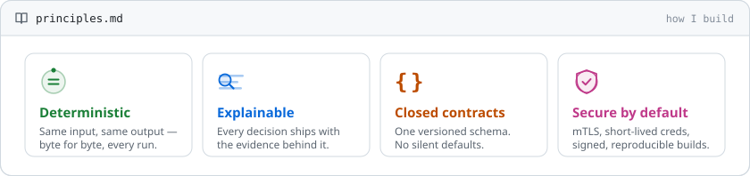

<!--
  Profile README · AnkushBL6
  Every card ships in a light and a dark version (assets/light, assets/dark) and GitHub picks the one
  that matches the visitor's theme. All motion is CSS/SMIL inside the SVGs; fonts are GitHub's Mona Sans.
  The contribution skyline is rendered daily by .github/workflows/skyline.yml into the `output` branch.
-->

  <picture>
    <source media="(prefers-color-scheme: dark)" srcset="https://raw.githubusercontent.com/AnkushBL6/AnkushBL6/main/assets/dark/header.svg" />
    <source media="(prefers-color-scheme: light)" srcset="https://raw.githubusercontent.com/AnkushBL6/AnkushBL6/main/assets/light/header.svg" />
    
  </picture>

  <picture>
    <source media="(prefers-color-scheme: dark)" srcset="https://raw.githubusercontent.com/AnkushBL6/AnkushBL6/main/assets/dark/whoami.svg" />
    <source media="(prefers-color-scheme: light)" srcset="https://raw.githubusercontent.com/AnkushBL6/AnkushBL6/main/assets/light/whoami.svg" />
    
  </picture>

  <picture>
    <source media="(prefers-color-scheme: dark)" srcset="https://raw.githubusercontent.com/AnkushBL6/AnkushBL6/main/assets/dark/focus.svg" />
    <source media="(prefers-color-scheme: light)" srcset="https://raw.githubusercontent.com/AnkushBL6/AnkushBL6/main/assets/light/focus.svg" />
    
  </picture>

  <picture>
    <source media="(prefers-color-scheme: dark)" srcset="https://raw.githubusercontent.com/AnkushBL6/AnkushBL6/main/assets/dark/stack.svg" />
    <source media="(prefers-color-scheme: light)" srcset="https://raw.githubusercontent.com/AnkushBL6/AnkushBL6/main/assets/light/stack.svg" />
    
  </picture>

  <picture>
    <source media="(prefers-color-scheme: dark)" srcset="https://raw.githubusercontent.com/AnkushBL6/AnkushBL6/main/assets/dark/principles.svg" />
    <source media="(prefers-color-scheme: light)" srcset="https://raw.githubusercontent.com/AnkushBL6/AnkushBL6/main/assets/light/principles.svg" />
    
  </picture>

  <picture>
    <source media="(prefers-color-scheme: dark)" srcset="https://raw.githubusercontent.com/AnkushBL6/AnkushBL6/output/skyline-dark.svg" />
    <source media="(prefers-color-scheme: light)" srcset="https://raw.githubusercontent.com/AnkushBL6/AnkushBL6/output/skyline-light.svg" />
    
  </picture>

  <picture>
    <source media="(prefers-color-scheme: dark)" srcset="https://raw.githubusercontent.com/AnkushBL6/AnkushBL6/main/assets/dark/footer.svg" />
    <source media="(prefers-color-scheme: light)" srcset="https://raw.githubusercontent.com/AnkushBL6/AnkushBL6/main/assets/light/footer.svg" />
    
  </picture>

<!--
  Want contact links? Uncomment and fill in, e.g.:
  

    
    
  

-->
